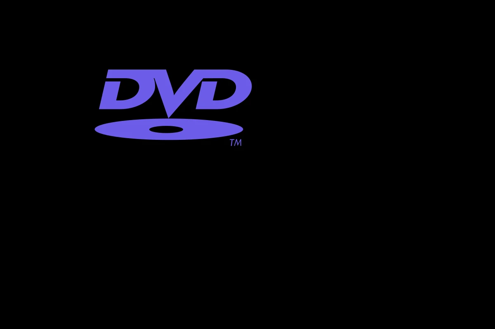
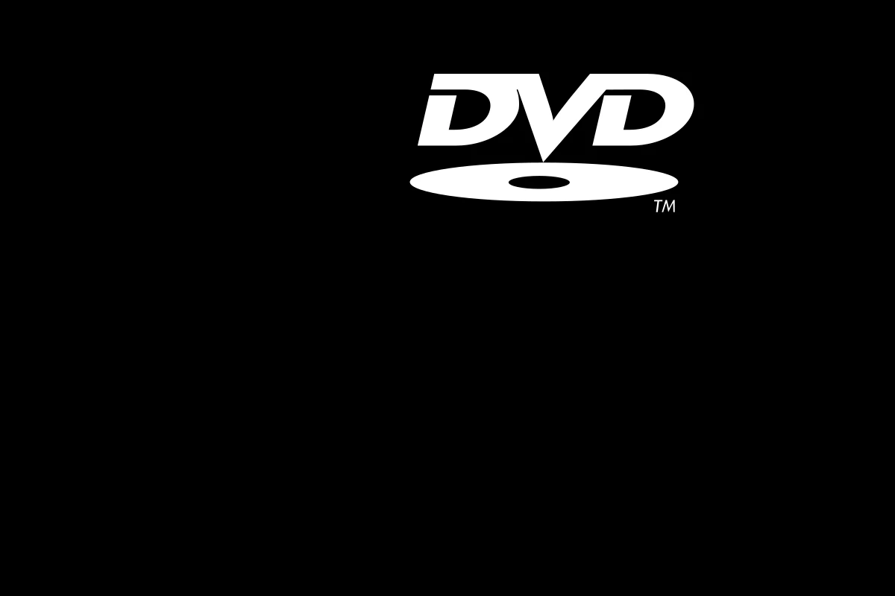

# Scranton DVD

A Mac screensaver. The DVD logo bounces around your screen, changing colour when it hits the edges.

**[Download the latest version](https://github.com/ozgurdesign/scranton-dvd/releases/latest)** · [ozgur.ca](https://ozgur.ca/projects/scranton-dvd)

## Modes

<table>
  <tr>
    <th width="33%">Classic</th>
    <th width="33%">Colorful</th>
    <th width="33%">Monochrome</th>
  </tr>
  <tr>
    <td width="33%"></td>
    <td width="33%"></td>
    <td width="33%"></td>
  </tr>
  <tr>
    <td width="33%">Coloured logo on black, random colour on edge hit</td>
    <td width="33%">Coloured logo on inverted background, random colours on edge hit</td>
    <td width="33%">White logo on black</td>
  </tr>
</table>

Switch modes with the Options button in System Settings › Screen Saver.

## Download

Each release has one zip, `ScrantonDVD-<version>.zip`, holding `Scranton DVD.saver`. It runs on macOS 13 Ventura and later, on Apple silicon and Intel.

The "Source code" links GitHub adds to every release only contain this README, the screenshots and the licence. The screensaver is the `.zip`.

## Install

1. Unzip the download and double-click `Scranton DVD.saver`.
2. The screensaver is not notarized, so macOS may ask you to approve it in System Settings › Privacy & Security.
3. Pick Scranton DVD in System Settings › Screen Saver.

### Thumbnail not showing in the picker?

macOS Sonoma and later cache screensaver thumbnails per bundle. Reinstalling the same bundle keeps the empty cached entry. Clear the cache:

```
killall WallpaperAgent 2>/dev/null
rm -rf "$(getconf DARWIN_USER_CACHE_DIR)/com.apple.wallpaper.extension.legacy/com.apple.wallpaper.legacy.thumbnails/"*
```

Then reopen System Settings › Screen Saver.

## Uninstall

```
rm -rf ~/Library/Screen\ Savers/Scranton\ DVD.saver
```

## Trivia

The cold open of "Launch Party" (The Office, Season 4, Episode 5, aired October 11, 2007) was written by Jennifer Celotta and inspired by a real moment in the writers' room, where they had argued for ages about whether the DVD logo would hit the corner. On screen, the office watches the logo bounce on the conference room TV behind Michael, waiting for the perfect corner hit.

The catch: there was no logo on the TV during filming. The cast reacted to a blue screen, and a bouncing logo was added in post-production, timed to nail the corner on cue. The most famous corner-hit in television history was an edit.

The other catch: the logo on the TV in the show isn't the swooshy one this screensaver recreates. The production swapped in a square "DVD VIDEO" badge instead, because a square logo can actually tuck flush into a screen corner. The real swooshy logo, with its irregular silhouette, would have never lined up cleanly enough to sell the moment.

## About this repository

This repository hosts releases only. The source code is not public, and issues and pull requests are turned off.

## Licence

Scranton DVD by [Oz Gultekin](https://ozgur.ca) is licensed under [CC BY-NC-ND 4.0](https://creativecommons.org/licenses/by-nc-nd/4.0/). See [LICENSE](LICENSE).
